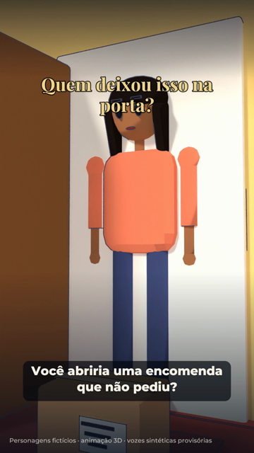
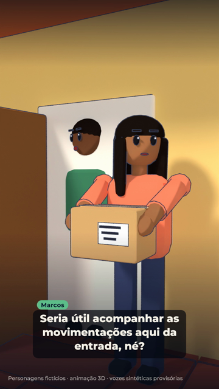
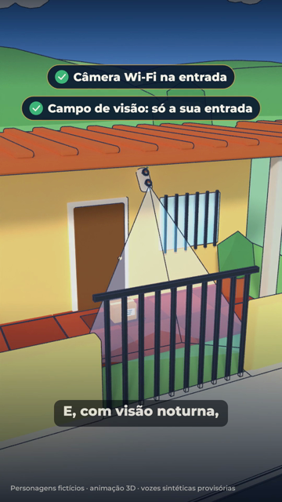
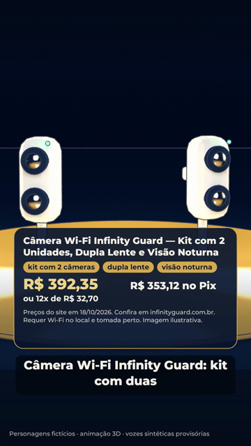
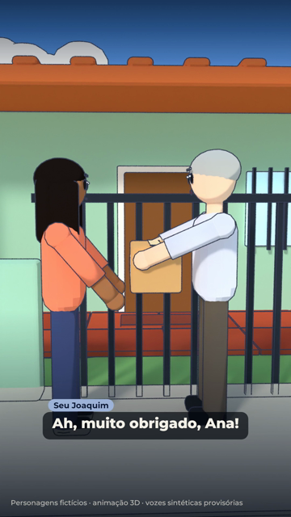
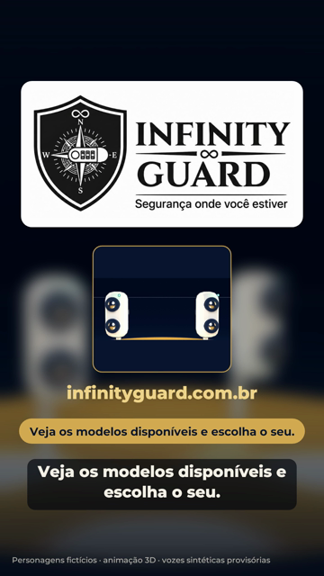

# Storyboard — Quem deixou isso na porta?

1080x1920 (9:16), 24 fps · 50 s · produto: Câmera Wi-Fi Infinity Guard — Kit com 2 Unidades, Dupla Lente e Visão Noturna · CTA: Veja os modelos disponíveis e escolha o seu. · infinityguard.com.br

Personagens fictícios: **Ana** — moradora, 30 e poucos anos, pele parda, cabelo preto longo, blusa coral (fictícia); **Marcos** — marido da Ana, pele negra, cabelo curto, camisa verde (fictício); **Seu Joaquim** — vizinho da casa ao lado, pele clara, cabelo grisalho, camisa clara (fictício)

Narrador: kokoro:pm_alex — **PROVISÓRIA**: voz Dave não disponível: nenhuma ferramenta de áudio com a Dave configurada (falta voz_dave/ com AUTORIZACAO.txt e um arquivo por fala do narrador)

## 1. A encomenda na porta (0–5 s · tomada P1)

- **Ação:** Varanda de casa térrea com piso de cerâmica vermelha. A porta abre, Ana aparece e olha para uma caixa no tapete.
- **Câmera:** Câmera baixa na varanda, ao lado da caixa, subindo devagar até o rosto de Ana.
- **narrador** (0.5 s): "Você abriria uma encomenda que não pediu?"
- **Tela** (0.5 s): Quem deixou isso na porta?

## 2. A etiqueta (5–14 s · tomada P2)

- **Ação:** Ana segura a caixa e lê a etiqueta (inserção em close: destinatário Joaquim Ribeiro, casa 14). Marcos chega à porta e comenta.
- **Câmera:** Plano médio dos dois na porta, leve aproximação.
- **Ana** (5.6 s): "Joaquim Ribeiro? Não mora ninguém com esse nome aqui."
- **Marcos** (9.6 s): "Seria útil acompanhar as movimentações aqui da entrada, né?"
- **Tela** (6.0 s): Para: Joaquim Ribeiro · Rua das Acácias, 14

## 3. Câmera bem posicionada (14–27 s · tomada P3)

- **Ação:** Vista de fora: câmera Wi-Fi na parede acima da porta, com o campo de visão desenhado cobrindo só a varanda e o portão da própria casa; a casa do vizinho fica fora. O dia vira noite.
- **Câmera:** Plano aberto do lado de fora, aproximação lenta.
- **narrador** (14.5 s): "Uma câmera Wi-Fi bem posicionada mostra a entrada da sua casa, sem invadir o espaço do vizinho."
- **narrador** (21.8 s): "E, com visão noturna, a entrada continua à vista também à noite."
- **Tela** (15.5 s): Câmera Wi-Fi na entrada
- **Tela** (18.0 s): Campo de visão: só a sua entrada
- **Tela** (22.0 s): Visão noturna

## 4. O produto (27–39 s · tomada P4)

- **Ação:** Kit com 2 câmeras de lente dupla girando num pedestal dourado; cartão com nome, destaques confirmados e preço do catálogo.
- **Câmera:** Câmera de estúdio girando devagar em volta do pedestal.
- **narrador** (27.5 s): "Quer acompanhar melhor a entrada da sua casa? Conheça nossas câmeras de segurança."
- **narrador** (33.2 s): "Câmera Wi-Fi Infinity Guard: kit com duas câmeras, dupla lente e visão noturna."
- **Tela** (28.0 s): cartão do produto — Câmera Wi-Fi Infinity Guard — Kit com 2 Unidades, Dupla Lente e Visão Noturna; destaques: kit com 2 câmeras, dupla lente, visão noturna; preço do catálogo de 2026-10-18; requisitos: Wi-Fi no local, tomada perto

## 5. Entrega certa (39–47 s · tomada P5)

- **Ação:** Ana leva a caixa até o portão da casa ao lado e entrega ao Seu Joaquim, que agradece. Ela acena.
- **Câmera:** Acompanha Ana pela calçada e para de lado, com os dois de perfil.
- **Ana** (39.6 s): "Seu Joaquim, isso chegou lá em casa por engano!"
- **Seu Joaquim** (43.0 s): "Ah, muito obrigado, Ana!"

## 6. Encerramento (47–50 s · tomada cartela)

- **Ação:** Cartela: o kit, o logo original com o slogan, o site e o CTA.
- **Câmera:** Cartela fixa com entrada suave.
- **narrador** (47.1 s): "Veja os modelos disponíveis e escolha o seu."
- **Tela** (47.0 s): kit, logo original com o slogan, infinityguard.com.br e o CTA

## Regras do episódio

- Não usar rosto ou avatar do proprietário.
- Não mostrar consulta de imagens no aplicativo: a função não está confirmada no catálogo para este modelo.
- Não afirmar que a câmera identificou o entregador.
- Preço, nome e destaques saem do catálogo; nada de promoção, frete, garantia ou parcelamento sem juros.
