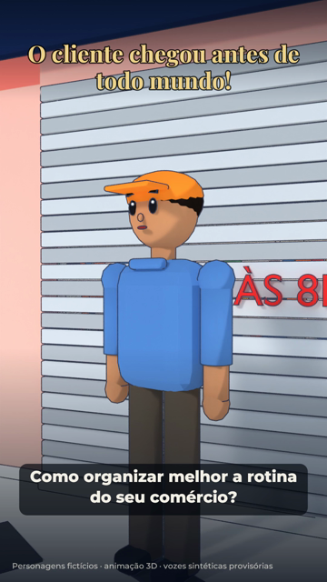
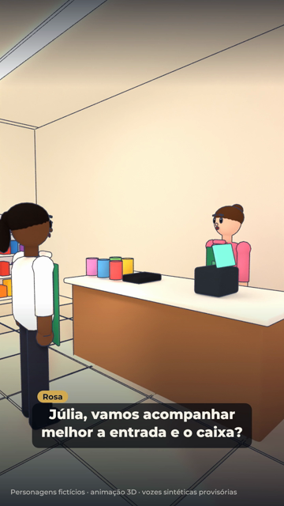
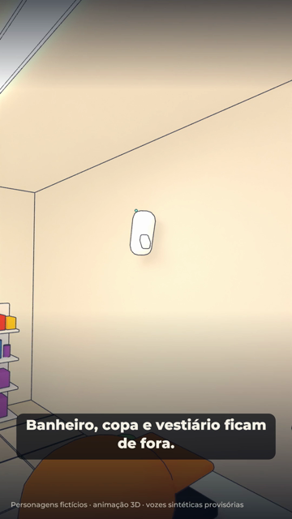
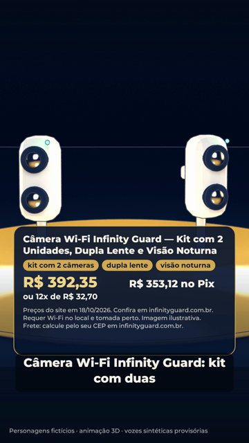
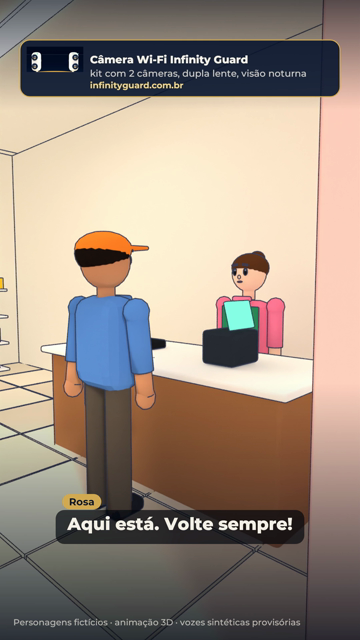
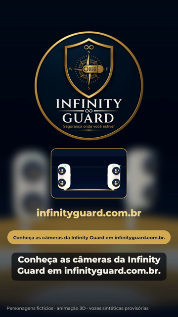

# Storyboard — O cliente chegou antes de todo mundo!

1080x1920 (9:16), 24 fps · 50 s · produto: Câmera Wi-Fi Infinity Guard — Kit com 2 Unidades, Dupla Lente e Visão Noturna · CTA: Conheça as câmeras da Infinity Guard em infinityguard.com.br. · infinityguard.com.br

Personagens fictícios: **Rosa** — dona da loja de variedades, pele clara, cabelo castanho em coque, blusa rosa e avental verde (fictícia); **Júlia** — funcionária, pele negra, rabo de cavalo, blusa clara e avental verde (fictícia); **Paulo** — cliente, pele morena, boné laranja, camisa azul (fictício)

Narrador: kokoro:pm_alex — **PROVISÓRIA**: voz Dave não disponível: nenhuma ferramenta de áudio com a Dave configurada (falta voz_dave/ com AUTORIZACAO.txt e um arquivo por fala do narrador)

## 1. Chegou cedo (0–5 s · tomada L1 (0–2.6 s), L2 (2.6–5 s))

- **Ação:** Rua de comércio de bairro, calçada de pedras em ondas. Paulo chega à Variedades da Rosa e encontra a porta de enrolar fechada (placa: abre às 8h). Corte para close: ele olha o relógio.
- **Câmera:** Plano aberto da calçada acompanhando Paulo; corte para close com fundo desfocado.
- **narrador** (0.4 s): "Seu cliente chegou antes de você. Como organizar melhor a rotina do seu comércio?"
- **Tela** (0.4 s): O cliente chegou antes de todo mundo!

## 2. A loja abre (5–15 s · tomada L3 (5–9 s), L4 (9–15 s))

- **Ação:** A porta de enrolar sobe, Rosa acena e convida Paulo a entrar. Corte para dentro: Rosa no caixa conversa com Júlia sobre acompanhar a entrada e o caixa; Paulo escolhe produtos ao fundo.
- **Câmera:** Da calçada para dentro da loja; depois plano interno com os três em quadro.
- **Rosa** (5.6 s): "Bom dia! Desculpa a demora, pode entrar."
- **Rosa** (9.3 s): "Júlia, vamos acompanhar melhor a entrada e o caixa?"
- **Júlia** (12.3 s): "Boa! Mas banheiro e estoque ficam de fora, né?"

## 3. Planejamento (15–29 s · tomada L5 (15–23 s), L6 (23–29 s))

- **Ação:** Vista de cima da loja: o campo de visão de uma câmera cobre a entrada e o de outra cobre o caixa; o banheiro e o estoque aparecem marcados como área privada, sem câmera. Depois, a câmera na parede e a equipe atendendo normalmente.
- **Câmera:** Plano de cima girando devagar; corte para a câmera na parede e depois para o balcão.
- **narrador** (15.4 s): "Primeiro, o planejamento: câmera só nas áreas de atendimento, como a entrada e o caixa."
- **narrador** (21.2 s): "Banheiro, copa e vestiário ficam de fora."
- **narrador** (23.9 s): "A câmera ajuda a acompanhar a rotina. Não substitui a sua equipe nem o atendimento."
- **Tela** (16.6 s): Entrada
- **Tela** (18.1 s): Caixa
- **Tela** (20.9 s): Banheiro e estoque: sem câmera

## 4. O produto (29–41 s · tomada K1)

- **Ação:** Kit com 2 câmeras de lente dupla girando no pedestal; cartão com nome, destaques, requisitos de conexão, preço, Pix, parcelas e frete por CEP, tudo do catálogo.
- **Câmera:** Câmera de estúdio girando devagar em volta do pedestal.
- **narrador** (29.4 s): "Sua loja tem necessidades próprias. Escolha um equipamento compatível com seu espaço."
- **narrador** (34.8 s): "Câmera Wi-Fi Infinity Guard: kit com duas câmeras, dupla lente e visão noturna."
- **Tela** (29.6 s): cartão do produto — Câmera Wi-Fi Infinity Guard — Kit com 2 Unidades, Dupla Lente e Visão Noturna; destaques: kit com 2 câmeras, dupla lente, visão noturna; preço do catálogo de 2026-10-18; requisitos: Wi-Fi no local, tomada perto

## 5. Atendimento de sempre (41–45 s · tomada L7)

- **Ação:** Rosa entrega a sacola a Paulo no balcão, ele agradece e sai; Júlia arruma as prateleiras. O produto aparece num selo no canto.
- **Câmera:** Plano do balcão com os dois de perfil.
- **Rosa** (41.6 s): "Aqui está. Volte sempre!"
- **Paulo** (43.7 s): "Obrigado, até amanhã!"

## 6. Encerramento (45–50 s · tomada cartela)

- **Ação:** Logo original navy e dourado com o slogan, o kit, o site e o CTA.
- **Câmera:** Cartela fixa com entrada suave.
- **narrador** (45.5 s): "Conheça as câmeras da Infinity Guard em infinityguard.com.br."
- **Tela** (45.4 s): kit, logo original com o slogan, infinityguard.com.br e o CTA

## Regras do episódio

- Personagens fictícios; sem rosto ou avatar do proprietário.
- Câmeras só em áreas comerciais (entrada e caixa); banheiro, estoque, copa e vestiário ficam de fora.
- Não mostrar visualização de imagens no aplicativo: a função não está confirmada no catálogo para este modelo.
- Não sugerir que a câmera substitui atendimento, equipe ou segurança física.
- Preço, recursos, requisitos e frete saem do catálogo (frete: só o cálculo por CEP, que é o que o catálogo confirma).
