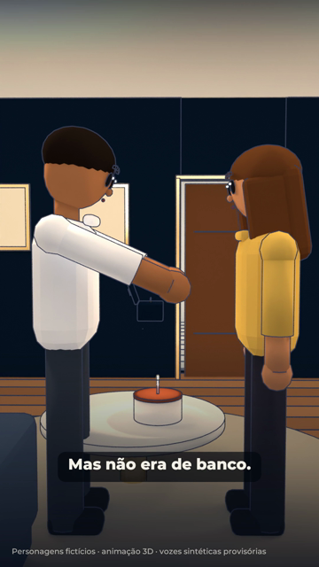
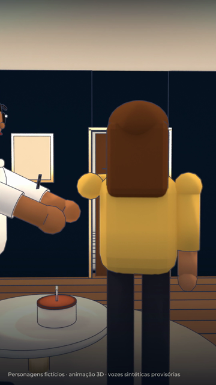
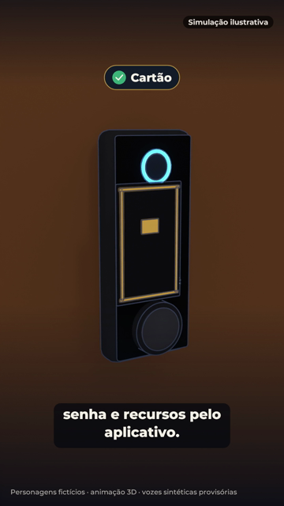
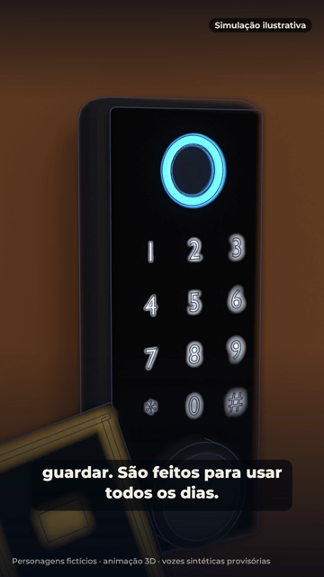
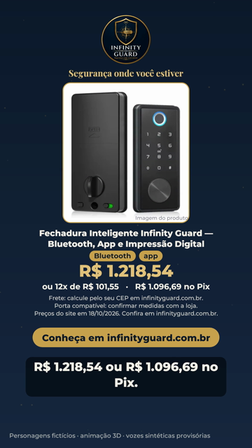

# Storyboard — O presente que ninguém esperava

1080x1920 (9:16), 24 fps · 55 s · produto: Fechadura Inteligente Infinity Guard — Bluetooth, App e Impressão Digital · CTA: Conheça em infinityguard.com.br · infinityguard.com.br

Personagens fictícios: **Ela** — mulher adulta, pele morena, cabelo castanho longo, blusa dourada (fictícia); **Ele** — marido, pele parda, cabelo curto, camisa branca (fictício)

Narrador: kokoro:pm_alex — **PROVISÓRIA**: voz Dave não disponível: nenhuma ferramenta de áudio com a Dave configurada (falta voz_dave/ com AUTORIZACAO.txt e um arquivo por fala do narrador)

## 1. O cartão (0–5 s · tomada A1)

- **Ação:** Sala de apartamento à noite, luz quente, bolo de aniversário na mesa de centro. Ela entrega uma caixinha azul-marinho com fita dourada; ele abre e tira um pequeno cartão preto.
- **Câmera:** Plano médio dos dois, aproximação lenta, fundo desfocado.
- **narrador** (0.2 s): "No aniversário dele, ela entregou um cartão. Mas não era de banco. Nem de presente."

## 2. O mistério (5–18 s · tomada A2 (5–11 s), A3 (11–18 s))

- **Ação:** Close nele virando o cartão, intrigado. Ela se vira e aponta para a porta; a câmera atravessa a sala até a porta de entrada, na parede azul-marinho com friso dourado, onde há uma fechadura nova.
- **Câmera:** Close com fundo desfocado; depois movimento contínuo da sala até a porta.
- **narrador** (5.6 s): "Ele procurou uma mensagem, um valor, uma explicação. Até perceber que o presente estava bem na frente dele."

## 3. A revelação (18–37 s · tomada A4 (18–27 s), A5 (27–37 s))

- **Ação:** Lado de fora da porta: a fechadura preta (painel com anel do leitor, teclado de toque e puxador redondo) revelada em close, o teclado acende. Simulação ilustrativa: o cartão se aproxima do teclado, bipe, a lingueta recolhe e a porta abre para a sala.
- **Câmera:** Close macro girando devagar em volta da fechadura; depois plano do cartão no teclado e a porta abrindo.
- **narrador** (18.6 s): "Ela escolheu uma forma diferente de presentear: mais praticidade para os dias que ainda estão por vir."
- **narrador** (25.6 s): "Uma fechadura inteligente com acesso por cartão, senha e recursos pelo aplicativo."
- **Tela** (28.6 s): Cartão
- **Tela** (30.0 s): Senha
- **Tela** (31.4 s): Recursos pelo aplicativo

## 4. Para usar todos os dias (37–44 s · tomada A6 (37–41 s), A7 (41–44.0 s))

- **Ação:** O casal sorri junto à porta aberta. Close no cartão diante da fechadura.
- **Câmera:** Plano médio do casal; corte para close com fundo desfocado.
- **narrador** (37.5 s): "Porque alguns presentes não são feitos para guardar. São feitos para usar todos os dias."

## 5. Packshot e oferta (44–55 s · tomada cartela)

- **Ação:** Fundo azul-marinho com partículas douradas: logo original, slogan, foto real da fechadura preta, nome do produto, destaques e oferta do catálogo, site.
- **Câmera:** Cartela com entrada suave.
- **narrador** (44.2 s): "Fechadura Inteligente Infinity Guard. {preco} ou {pix} no Pix. Conheça em infinityguard.com.br."

## Regras do episódio

- Personagens fictícios; sem foto ou avatar do proprietário; sem diálogos além do narrador.
- A abertura por cartão é simulação ilustrativa (selo na tela de 18 a 45 s).
- Não mostrar abertura remota pelo celular nem por Wi-Fi; aplicativo só citado.
- Biometria não é demonstrada (o produto aparece como é, com o leitor, mas ninguém usa).
- Cartão e senha foram informados pelo dono e não estão nos destaques do catálogo: conferir na página do produto.
- Sem 'sem juros' e sem 'frete grátis' (não confirmados no catálogo); frete pelo CEP.
- Compatibilidade da porta: o catálogo pede confirmar as medidas com a loja (a faixa de 38 a 55 mm do briefing não está no catálogo).
