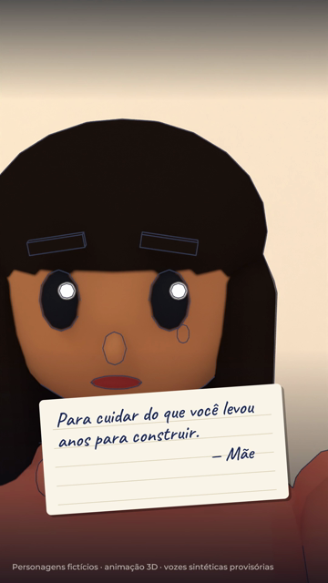
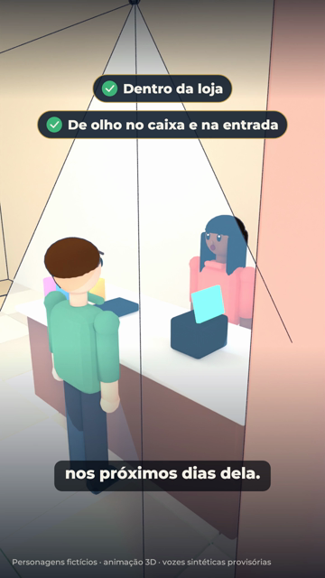

# Storyboard — O primeiro presente da loja

1080x1920 (9:16), 24 fps · 55 s · produto: Câmera Dome ASECAM 8MP 4K com Alimentação PoE para Monitoramento Externo · CTA: Link na bio · infinityguard.com.br · infinityguard.com.br

Personagens fictícios: **Bia** — empreendedora, dona do Ateliê da Bia, pele parda, cabelo preto longo, blusa coral (fictícia); **Dona Lúcia** — mãe da Bia, cabelo grisalho em coque, blusa lilás (fictícia); **Cliente** — primeira cliente da loja (fictícia)

Narrador: kokoro:pm_alex — **PROVISÓRIA**: voz Dave não disponível: nenhuma ferramenta de áudio com a Dave configurada (falta voz_dave/ com AUTORIZACAO.txt e um arquivo por fala do narrador)

## 1. Gancho: a caixa (0–5 s · tomada I1)

- **Ação:** Dia da inauguração do Ateliê da Bia: balões navy e dourados, faixa 'INAUGURAÇÃO'. Bia abre no balcão uma caixa azul-marinho com fita dourada; na tampa, um bilhete.
- **Câmera:** Plano médio do balcão, aproximação lenta, fundo desfocado.
- **narrador** (0.12 s): "Ela passou cinco anos sonhando com aquela loja. Mas não esperava receber isso no primeiro dia."

## 2. Início: a véspera e o bilhete (5–17 s · tomada I2 (5–11 s), I3 (11–17 s))

- **Ação:** Lembrança (tom sépia): na véspera, à noite, Bia arruma sozinha as prateleiras entre caixas de papelão. De volta ao presente: close dela lendo o bilhete, reconhece a letra da mãe e se emociona.
- **Câmera:** Plano interno com luz baixa; corte para close com fundo desfocado.
- **narrador** (5.6 s): "Cada prateleira tinha uma história. Cada detalhe, um sacrifício. E alguém tinha percebido isso."
- **Tela** (5.2 s): Na véspera

## 3. Desenvolvimento: o presente (17–37 s · tomada I4 (17–24 s), I5 (24–31 s), I6 (31–37 s))

- **Ação:** Dentro da caixa, sobre papel de seda, a câmera dome branca. A mãe, Dona Lúcia, chega e as duas se abraçam. A câmera aparece girando em estúdio, fiel à foto do produto.
- **Câmera:** Close da caixa; plano médio do abraço; produto girando em fundo azul-marinho.
- **narrador** (17.5 s): "Não era um presente para decorar a loja. Era uma forma de participar daquele sonho."
- **narrador** (24.4 s): "Uma câmera para ajudar a acompanhar o espaço que ela acabava de conquistar."

## 4. Transformação: instalada (37–45 s · tomada I7)

- **Ação:** A câmera dome instalada no teto, dentro da loja, no canto do balcão, com o campo de visão no caixa e na entrada. Bia atende a primeira cliente.
- **Câmera:** Detalhe da câmera no teto, depois plano aberto do balcão.
- **narrador** (37.5 s): "Porque apoiar uma conquista também é pensar nos próximos dias dela."
- **Tela** (38.2 s): Dentro da loja
- **Tela** (39.6 s): De olho no caixa e na entrada

## 5. Encerramento (45–55 s · tomada cartela)

- **Ação:** Packshot: logo original, foto da câmera dome, selo Black Friday (26 a 29/11, link na bio) e o CTA 'Link na bio'.
- **Câmera:** Cartela com entrada suave.
- **narrador** (45.2 s): "Uma conquista merece atenção em cada detalhe. Conheça as câmeras de segurança da Infinity Guard. Acesse infinityguard.com.br."
- **Tela** (45.0 s): packshot com a foto do produto, logo original, preço e condições do catálogo, selo Black Friday: 26 a 29/11 · acompanhe pelo link da bio e o CTA "Link na bio · infinityguard.com.br"

## Regras do episódio

- Personagens fictícios; sem foto, rosto, clone ou avatar do proprietário.
- Produto do catálogo (página lida em 25/10/2026): nome, preço, Pix, 8x sem juros, frete grátis, destaques e requisito (cabo de rede com equipamento PoE) saem do catálogo; a narração não cita recursos.
- Câmera instalada dentro da loja, no teto, mirando caixa e entrada (sem uso externo).
- Black Friday ainda é proposta (cupom e preços não confirmados): só nome, datas e link na bio.
- Sem medo nem violência como gatilho.
