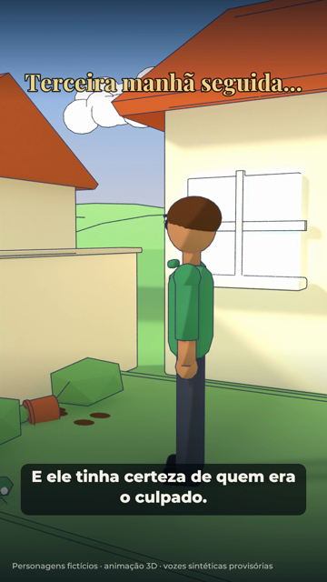
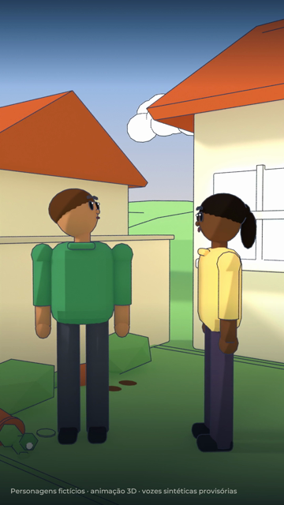
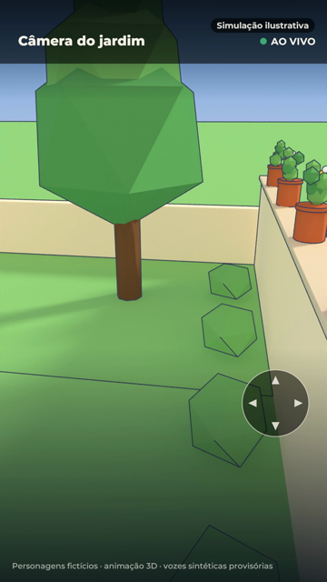
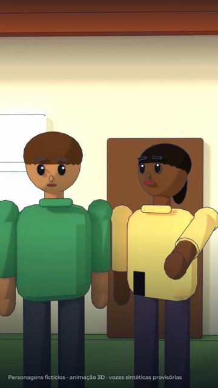

# Storyboard — O mistério das plantas

1080x1920 (9:16), 24 fps · 55 s · produto: Câmera ASECAM PTZ 4K 8MP — Wi-Fi, PoE e Rastreamento Inteligente · CTA: Acesse infinityguard.com.br · infinityguard.com.br

Personagens fictícios: **Ele** — morador, pele morena, cabelo castanho curto, camiseta verde (fictício); **Ela** — esposa, pele negra, rabo de cavalo, blusa amarela (fictícia); **O gato** — gato laranja da vizinhança (fictício)

Narrador: kokoro:pm_alex — **PROVISÓRIA**: voz Dave não disponível: nenhuma ferramenta de áudio com a Dave configurada (falta voz_dave/ com AUTORIZACAO.txt e um arquivo por fala do narrador)

## 1. Gancho: três vasos no chão (0–5 s · tomada J1)

- **Ação:** Manhã no jardim da casa com garagem: três vasos de barro derrubados junto ao muro. Ele sai de casa, vê o estrago e olha desconfiado para o muro do vizinho.
- **Câmera:** Plano aberto do jardim, aproximação lenta.
- **narrador** (0.15 s): "Três manhãs. Três vasos no chão. E ele tinha certeza de quem era o culpado."
- **Tela** (0.4 s): Terceira manhã seguida...

## 2. Início: observar antes de acusar (5–17 s · tomada J2 (5–11 s), J3 (11–17 s))

- **Ação:** Ele recolhe a terra; a esposa chega com o café e conversa. Ela sugere observar antes de acusar e aponta para a quina da casa.
- **Câmera:** Plano médio dos dois junto ao muro.
- **narrador** (5.6 s): "Antes de reclamar com o vizinho, a esposa teve uma ideia: observar a área de um jeito diferente."

## 3. Desenvolvimento: a câmera PTZ (17–35 s · tomada J4 (17–26 s), J5 (26–35 s))

- **Ação:** A câmera ASECAM PTZ aparece na quina da casa, voltada para o jardim e a garagem; a cabeça gira para um lado e para o outro. Depois, a visão ilustrativa no aplicativo: o jardim, o muro com os vasos e a garagem.
- **Câmera:** De baixo para a câmera na parede; depois a imagem da câmera em tela cheia com a interface do app.
- **narrador** (17.6 s): "Eles escolheram uma câmera PTZ para acompanhar o espaço. Com enquadramento ajustável e recursos inteligentes, conforme a configuração do modelo."
- **Tela** (19.6 s): Giro motorizado (cerca de 355°)
- **Tela** (21.2 s): Para área externa
- **Tela** (26.0 s): Câmera do jardim

## 4. Reviravolta: o culpado (35–45 s · tomada J6 (35–41 s), J7 (41–45 s))

- **Ação:** Na imagem da câmera, um gato laranja anda pelo muro atrás de uma borboleta dourada, pula e derruba um vaso. Corte: ele, sem graça, com a mão na testa; ela ri.
- **Câmera:** Imagem da câmera com a interface do app; depois plano médio do casal.
- **narrador** (35.8 s): "O vizinho era inocente. O verdadeiro responsável tinha quatro patas."
- **Tela** (35.0 s): Câmera do jardim

## 5. Encerramento (45–55 s · tomada cartela)

- **Ação:** Packshot: logo original, foto real da câmera ASECAM PTZ, nome, recursos da página do produto, preço, Pix, parcelas sem juros, frete grátis, requisitos e CTA.
- **Câmera:** Cartela com entrada suave.
- **narrador** (45.2 s): "Antes de imaginar, veja. Conheça a Câmera ASECAM PTZ 4K 8MP na Infinity Guard. Acesse infinityguard.com.br."
- **Tela** (45.0 s): packshot com a foto do produto, logo original, preço e condições do catálogo e o CTA "Acesse infinityguard.com.br"

## Regras do episódio

- Personagens fictícios; sem rosto, foto ou avatar do proprietário; sem vozes além do narrador.
- Recursos só da página do produto (26/10/2026); IP66 aparece só na imagem promocional e não é citado.
- A imagem no app é ilustrativa e ao vivo (sem gravação); não dizer que a câmera rastreia gatos.
- Sem promessa de cobertura integral ou de ausência de pontos cegos.
- Fonte de alimentação não inclusa na configuração básica: aparece no packshot.
