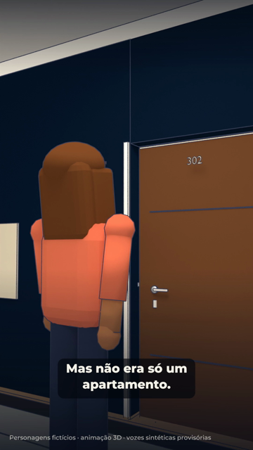
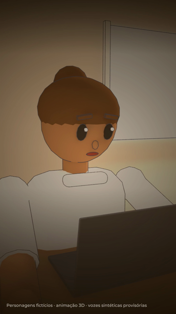
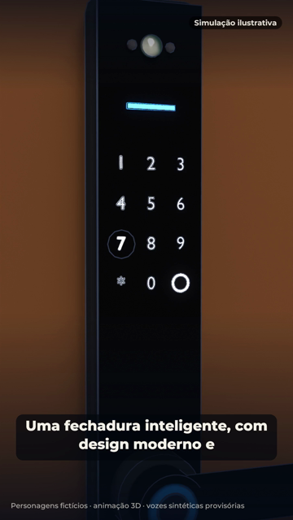
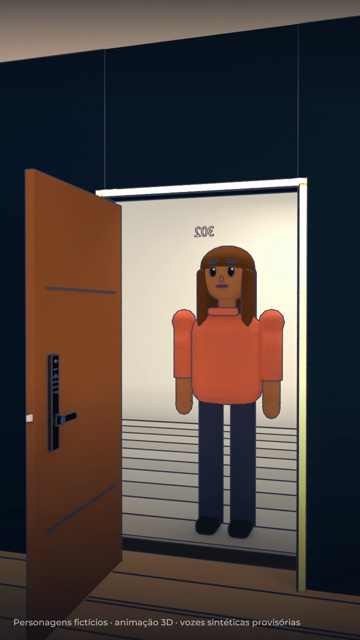

# Storyboard — A primeira porta

1080x1920 (9:16), 24 fps · 60 s · produto: Fechadura Inteligente Infinity Guard — Biometria, Senha, Cartão e App · CTA: Acesse agora o link da bio · infinityguard.com.br

Personagens fictícios: **Ela** — mulher adulta, pele parda, cabelo castanho, blusa terracota (fictícia); **Técnico** — homem adulto, uniforme cinza sem marca (fictício)

Narrador: kokoro:pm_alex — **PROVISÓRIA**: voz Dave não disponível: nenhuma ferramenta de áudio com a Dave configurada (falta voz_dave/ com AUTORIZACAO.txt e um arquivo por fala do narrador)

## 1. Gancho: sete anos (0–5 s · tomada Q1)

- **Ação:** Corredor do prédio no fim da tarde. Ela caminha de costas para a câmera e para diante da porta 302, numa parede azul-marinho com friso dourado.
- **Câmera:** Atrás dela, lente baixa, aproximação lenta.
- **narrador** (0.2 s): "Ela esperou sete anos por aquela porta. Mas não era só um apartamento."

## 2. Lembranças: estudo, trabalho e planos (5–18 s · tomada Q2 (5–9.5 s), Q3 (9.5–13.5 s), Q4 (13.5–16 s), Q5 (16–18 s))

- **Ação:** Em tom sépia: ela estudando à noite com livros e abajur; trabalhando no notebook de dia; anotando contas e guardando moedas no pote, com o calendário riscado. Volta ao presente: as chaves com a etiqueta 302 balançam diante da porta.
- **Câmera:** Planos médios na escrivaninha com fundo desfocado; close macro nas chaves.
- **narrador** (5.5 s): "Foram anos de escolhas, trabalho e planos adiados. Até que aquele endereço finalmente passou a ser dela."

## 3. A escolha e a demonstração (18–38 s · tomada Q6 (18–24 s), Q7 (24–30 s), Q8 (30–38 s))

- **Ação:** Sala vazia com caixas de mudança: ela mede a porta e a fechadura antiga antes de escolher. Um técnico troca a maçaneta antiga pela fechadura preta de alavanca; o teclado acende. Simulação: o cartão encosta no teclado, bipe e a lingueta recolhe; depois um dedo digita a senha.
- **Câmera:** Plano médio na sala; plano da porta pelo corredor; close macro no painel.
- **narrador** (18.4 s): "E quando chegou a hora de transformar aquele espaço em lar, ela escolheu começar pela entrada."
- **narrador** (27.4 s): "Uma fechadura inteligente, com design moderno e diferentes formas de acesso."
- **Tela** (18.8 s): Antes: meça a fechadura atual
- **Tela** (31.0 s): Cartão
- **Tela** (34.3 s): Senha

## 4. A primeira entrada (38–48 s · tomada Q9 (38–44 s), Q10 (44–48 s))

- **Ação:** Ela digita a senha, o teclado confirma, ela abaixa a alavanca e a porta abre. De dentro, ela entra sorrindo na sala com luz de fim de tarde.
- **Câmera:** Plano médio pelo corredor; contraplano de dentro da sala.
- **narrador** (38.4 s): "Porque conquistar o próprio espaço é especial. E escolher cada detalhe dele também."

## 5. Packshot (48–60 s · tomada cartela)

- **Ação:** Fundo azul-marinho com partículas douradas: logo original com o slogan, foto real da fechadura (sem a marca do fornecedor), nome, recursos da página, preço, Pix, parcelas sem juros, frete grátis, medida da porta e CTA.
- **Câmera:** Cartela com entrada suave.
- **narrador** (48.2 s): "Fechadura Inteligente Infinity Guard. Mais praticidade para a sua rotina. Conheça o modelo e as condições de pagamento. Acesse agora o link da bio."
- **Tela** (48.0 s): packshot com a foto do produto, logo original, preço e condições do catálogo e o CTA "Acesse agora o link da bio"

## Regras do episódio

- Personagens fictícios; sem rosto, foto ou avatar do proprietário; só o narrador fala.
- Recursos só da página do produto IG-LOCK-001 lida em 27/10/2026 (SKU confirmado pelo dono).
- Demonstrados só cartão e senha (simulação ilustrativa, selo de 30 a 44 s). A biometria aparece no produto (anel na alavanca), mas não é usada nem destacada.
- Sem abertura remota por Wi-Fi; o app é citado só no packshot, como na página.
- Câmera, tela e campainha que aparecem na foto do fornecedor não estão na página: não são citadas. A marca do fornecedor foi retirada da foto.
- Compatibilidade: a faixa de 38 a 55 mm do briefing não está na página; o vídeo pede para medir a fechadura atual (guia de medidas).
- O vídeo não diz quem faz a instalação (a loja não oferece o serviço).
- Preço, Pix, 12x sem juros e frete grátis conferidos na página em 27/10/2026; estoque de 9 unidades não é citado (sem escassez).
